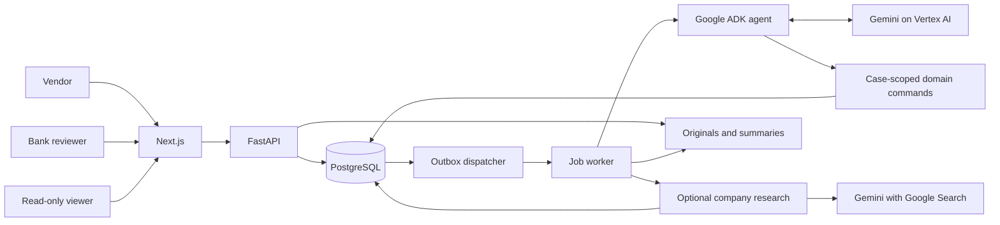

# Architecture

CaseProof separates model-assisted reading and planning from the rules that change a case. PostgreSQL stores case state, evidence versions, requests, reviewer decisions and job progress.

## Request and execution flow

1. The API checks the session, organisation membership, role and request revision. Uploads are saved as immutable originals and an agent job is queued.
2. The dispatcher delivers the job ID to a worker. A lease prevents another worker from applying the same job's effects.
3. Uploaded PDF text is sent to Gemini. Proposed fields must include passages that occur in the source; unsupported or ungrounded extraction is retained for review.
   When appearance checks are selected, a separate bounded call compares rendered pages with any supplied reference and examines visual anomalies. PDF drawing-order inspection also records covered text with a different value printed over it.
   Opt-in company research then runs three saved Google Search steps and an evidence-bound synthesis. The bank report retains sources, gaps and a dated assessment; it has no lending authority. See [the research method](CREDIT_RESEARCH.md).
   Added or edited policy criteria are assessed against the current document text, with validated source quotations. Missing evidence and uncertain findings feed the checklist and reviewer tasks.
4. The ADK agent reads the case and calls allowed tools. Domain services check arithmetic, delivery identity, replacements and current reviewer decisions.
5. Missing evidence produces a tracked request using a policy template. A written message produces a reviewer task with source references.
6. Completion rechecks the current evidence and open tasks, then freezes a summary snapshot. Later changes can reopen affected work and supersede that summary.

Waiting is represented by saved requests, tasks and timers. It does not keep an agent process or model call running.

## Code map

Paths below are relative to `services/backend/src/caseproof/`.

| Area                 | Modules                                                                        | Responsibility                                                                                                     |
| -------------------- | ------------------------------------------------------------------------------ | ------------------------------------------------------------------------------------------------------------------ |
| HTTP and identity    | `api/app.py`, `identity.py`, `actors.py`                                       | Sessions, roles, CSRF, idempotency and command validation                                                          |
| Vendor workspace     | `vendor.py`, `/v1/vendor/cases`                                                | Vendor contact access and a customer-facing view of issued requests, documents and replies                         |
| Evidence             | `intake.py`, `evidence.py`, `pdfdocs.py`, `storage.py`                         | Uploads, originals, parsed facts, versions and previews                                                            |
| Review rules         | `checks.py`, `casework.py`                                                     | Decimal calculations, receipt coverage, completion and reopening                                                   |
| Follow-up            | `requests.py`, `tasks.py`                                                      | Requests, replies, reminders, human decisions and retained disputes                                                |
| Policy               | `policies.py`, `policy_checks.py`, `automation/policy_review.py`, `catalog.py` | Version publication, grounded assessment of additional criteria, reviewer interpretations and scenario definitions |
| Agent                | `automation/agent.py`, `automation/tools.py`                                   | ADK instructions, tool bindings and case-scoped commands                                                           |
| Model calls          | `automation/gateway.py`, `automation/extract.py`                               | Reservations, usage, retries and grounded PDF extraction                                                           |
| Company research     | `credit_research.py`, `automation/research.py`                                 | Opt-in public searches, validated citation references, saved progress and report synthesis                         |
| Document appearance  | `document_checks.py`, `visual_pdf.py`, `automation/visual.py`                  | Case options, reference originals, PDF layers, image comparison and appearance tasks                               |
| Background execution | `jobs.py`, `queue.py`, `dispatcher.py`, `worker.py`, `automation/runner.py`    | Outbox delivery, leases, recovery and timer work                                                                   |
| Records and output   | `models.py`, `history.py`, `exports.py`, `views.py`                            | Database records, audit history, frozen snapshots, bank summaries and the client pack                              |

`automation/rules.py` is the fixed-rule controller used by tests and the evaluation baseline. It uses the same domain commands without a language model.

The frontend is in `apps/web/src/`. `app/(app)/` contains bank and viewer routes, `app/(vendor)/` contains the vendor portal, and `app/api/` proxies requests to FastAPI. Case and vendor components live under `components/`; shared controls are in `components/ui/`, with API clients, types and session handling in `lib/`. Downloadable documents are served from `apps/web/public/sample-documents/`.

## Agent tools and authority

The agent has nine tools: `read_case`, `inspect_source`, `compare_statements`, `run_checks`, `prepare_request`, `issue_request`, `wait_for_event`, `open_human_task` and `try_complete`.

Organisation, case, policy and lease scope come from the worker context. Model arguments cannot select another case, recipient or storage path. Tool commands use the same domain validation as API commands.

The agent can request evidence and propose review work. It cannot approve financing, change the application, make payments, publish policies or dismiss written messages without a recorded human decision.

## Evidence rules

- A separate deterministic control holds a case when its seller invoice already appears on another active or completed case in the same organisation. It does not replace the uploaded-document review engine or decide financing.

- Uploaded invoices are interpreted by Gemini across all line items, quantities, currencies and adjustments. Source-grounded calculation plans run through an exact decimal calculator before the final assessment.
- Receipt evidence is matched to invoices by meaning and supporting references, including partial and cumulative deliveries and evidenced unit conversions.
- A delivery reference identifies an event. Repeated copies of that event do not add quantity.
- An uploaded correction explicitly selects the source it replaces. Originals remain in history; the model assesses transaction differences and evidence. Legacy fixture corrections retain their deterministic policy rules.
- A rejected replacement opens a focused evidence decision. Authorising a further request does not accept that replacement or resolve the check.
- Every written message version needs a human disposition before completion, including messages classified as harmless or unrelated.
- Once other accepted evidence passes every check, a `document_rejection` task allows a reviewer to exclude an unnecessary rejected attachment. The file stays rejected and inactive; the decision, original and reason remain stored. Completion recomputes the checks and all other gates.
- Originals and previous versions remain available. A stored hash is checked when the original is retrieved.

The fixture parser reads visible labelled fields from the CPL-1 invoice and receipt forms, including fields arranged in columns. User uploads use visual reading of every PDF and rendered Word page, structured readers for spreadsheets/text, and Gemini assessment of every requirement. Visual calls combine transcription and field indexing; progress is persisted between batches. Previous versions remain comparison-only review context, and explicit numerical reconciliations constrain automatic passes. The field index preserves repeated items and raw notation; full source content remains available to review. The legacy fixture controller remains available for deterministic benchmark comparisons. Both paths retain the existing case, request and completion lifecycle. Prepared responses and walkthrough instructions are exposed only to the demo UI; the agent snapshot contains saved evidence and actions, with no future replies or expected outcomes.

Source passages make extracted values traceable; they do not guarantee correct interpretation. Reviewers can inspect the original and quoted facts in **Evidence**, then supply a clearer or corrected document when needed.

### Optional appearance review

A reviewer or supervisor can enable tampering triage and supply one reference PDF per document type. References are immutable, hashed and scoped to the case. These selections apply to later uploads; they cannot be disabled or replaced after findings arrive. Existing cases default to no appearance checks.

PDFium renders at most three pages per source, with bounded image size and object inspection. Gemini receives these images, reference images and bounded PDF clues through the existing budgeted gateway. Transaction values may differ from the reference. Editor metadata alone is not classified as tampering. Returned page numbers, regions and requested-check outcomes are validated; incomplete results require review. Native overlay findings cannot be cleared by a model response.

One pending source is processed per invocation. Committed results are reused, and lease/revision guards prevent stale results from being applied. Pending, suspicious or inconclusive appearance results block completion. A `document_review` task lets a reviewer record acceptance of appearance or keep the case on hold. Acceptance covers only the cited source versions and leaves the financial checklist intact. Superseding a document closes its obsolete appearance task and checks the replacement.

Findings, reference hashes and reviewer reasons are included in the frozen summary. Appearance checks do not establish authenticity, validate signatures or detect every forgery. Reference approval and issuer verification remain the bank's responsibility.

## Consistency and access

Mutating API requests use an idempotency key and expected revision. A stale revision returns HTTP 412. Related state changes, history entries and outbox work commit in one database transaction.

Runtime database roles do not have row-security bypass privileges. Organisation context is set for database access. Docker Compose and Cloud Run use the same access code before the seeded personas can sign in. Identity-Aware Proxy still applies when a verified assertion is present and development identities are off.

The browser receives raster document previews. Downloads and summaries require access to their case. Uploaded text and typed sender names are evidence, not authenticated proof of an organisation's identity.

Vendor accounts use separate `/v1/vendor/` routes. Within the organisation boundary, access is tied to `vendor_contact_id`; `created_by` retains the original uploader. Vendor submissions select their creator as contact. Bank reviewers can select a contact at creation or through a revision-guarded, audited command. The contact must be an active vendor in the same organisation. Removing or changing the contact revokes the previous contact's access; invoice names never grant access. The portal exposes issued bank requests and the case conversation, excluding drafts, internal tasks, policy, model traces and budgets. Vendor uploads and replies use the same ingestion, revisions, idempotency and job queue as bank uploads. New vendor cases are assigned to an active bank reviewer, preferring Alex in the local workspace. The API fixes reply attribution to the signed-in vendor and rejects vendor attempts to select bank review options.

Viewer accounts can read the bank workspace. The API rejects case-changing commands, independently of hidden or disabled controls. Session management remains available so all personas can sign out or change their permitted organisation.

### Local accounts

The sign-in page presents the three accounts from the submitted application: Alex, Sam and Aisha. Use **Switch persona** to follow a shared case across bank review, vendor replies and read-only viewing.

| Account                | Role and purpose                                                                                      |
| ---------------------- | ----------------------------------------------------------------------------------------------------- |
| Alex Chen              | Combined reviewer, supervisor, simulation operator and administrator roles for a complete walkthrough |
| Sam Lim (`dev:vendor`) | Vendor portal: submit documents and respond to bank requests on their own cases                       |
| Aisha Tan              | Viewer: read cases, documents and history without changing the case                                   |

These personas share the Straits Commercial review workflow. Li Wei in Lumen Bank remains available to organisation-isolation tests and is not shown in the persona picker. Existing case ownership, assignments and memberships are preserved.

## Policy and operating limits

Each case pins a published policy version. The supervisor editor creates a new version for new cases; existing cases change only through an explicit supervisor command. Templates, timers, permitted corrections and supported allowances are read from that version.

Additional and edited criteria are assessed by `automation/policy_review.py` through the governed Gemini gateway. `policy_checks.py` combines those findings with the core checks, validates evidence dependencies and opens focused review tasks. A retained assessment is bound to the policy ID and a hash of the current source versions and text. Citation validation rejects fabricated quotations and references outside the selected document scope. Replacements invalidate the assessment and any associated interpretation. Uncertain results block completion; a reviewer can record an evidence-supported interpretation or request further documents. A text criterion cannot override the core calculation, issuer or receipt checks.

Changing a receipt from cumulative quantities to quantities for a single delivery requires explicit permission to change its **Quantity basis** field. A supervisor can publish that permission before creating the case. The default policy and earlier cases retain their original restrictions.

Defaults are six model calls, sixteen tool calls and sixty seconds per invocation; twelve automatic runs and USD 0.50 per case. Retries and nested model calls share the allowance. Model calls reserve an estimated maximum cost before execution and reconcile reported usage afterwards.

Off mode disables agent actions. Shadow mode records proposals. Autonomous mode permits validated commands. Service failures and exhausted allowances pause automation with a reviewer task.

## Deployment

The local demo uses Docker Compose to manage PostgreSQL, the API, worker, dispatcher and production web server. A setup container applies migrations, seeds accounts and prepares storage and credentials before the services start. PostgreSQL and uploaded files persist in named volumes; see the [startup command](../README.md#run-locally).

Only the web port is published, on host loopback, in the production demo. The web shares the API's network namespace so persona authentication still arrives from loopback; the API and worker are not published to the host. Backend services run as the non-root application user. The setup container prepares volume permissions, then drops privileges before running migrations and seeding. The [development configuration](DEVELOPMENT.md) mounts source from the current checkout for live reload and exposes PostgreSQL on loopback port 56543 for local tools and tests.

The cloud configuration targets Cloud Run, Cloud SQL, Cloud Tasks, Cloud Scheduler and GCS. The access-code screen is the same one Docker Compose shows. The API stays private. The [deployment reference](DEPLOYMENT.md) describes configuration, setup order and [current limits](DEPLOYMENT.md#current-limits).
